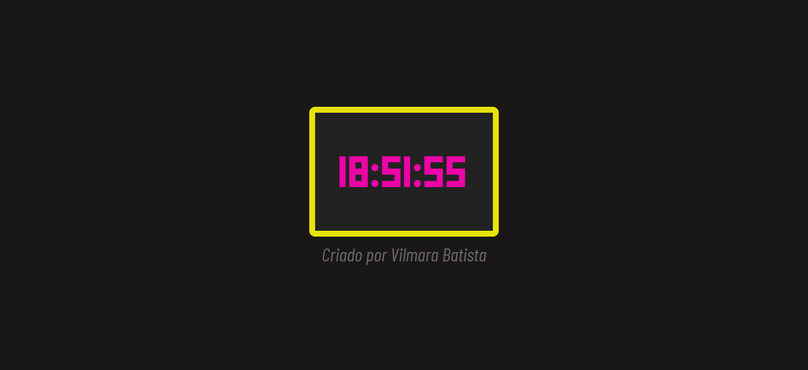

# ⏰ Relógio Digital

Projeto de um relógio digital desenvolvido para praticar conceitos de HTML, CSS e JavaScript.

## 🚀 Tecnologias utilizadas

- HTML5
- CSS3
- JavaScript

## ✨ Funcionalidades

- Exibição da hora atual.
- Atualização automática dos segundos.
- Interface simples e intuitiva.

## 💻 Como executar o projeto

1. Faça o download ou clone este repositório.
2. Abra a pasta do projeto.
3. Execute o arquivo `index.html` no navegador.

## 👩‍💻 Aprendizados

Este projeto foi desenvolvido como parte dos meus estudos de desenvolvimento web, com o objetivo de praticar HTML, CSS e JavaScript.

## 📸 Demonstração do projeto

